# PCmoa 사용자 가이드

처음 쓰는 사람을 위한 설명서입니다. 설치부터 실제 사용, 연결 해제와 삭제, 문제 해결까지 순서대로 정리했습니다.
빠른 설치만 필요하면 [README](../README.md)를 보세요.

> 화면 그림은 모두 실제 PCmoa v2.6 화면입니다. 주소(`192.168.0.10` 등)와 PC 이름은 예시라서, 여러분 화면에는 여러분 PC의 값이 보입니다.

## 목차

1. [설치와 첫 연결 (화면으로 따라 하기)](#1-설치와-첫-연결)
2. [기능별 사용법](#2-기능별-사용법)
3. [연결 해제와 완전 삭제](#3-연결-해제와-완전-삭제)
4. [자주 생기는 문제와 해결](#4-자주-생기는-문제와-해결)
5. [권한별로 할 수 있는 것](#5-권한별로-할-수-있는-것)
6. [안전하게 쓰기](#6-안전하게-쓰기)
7. [Windows / Linux 환경별 안내](#7-windows--linux-환경별-안내)

### 먼저 알아 둘 말

| 말 | 뜻 |
|---|---|
| **메인 PC** | PCmoa 서버를 켜 두는 PC. 대시보드가 여기서 돌아갑니다. |
| **연결할 PC** | 메인 PC에서 관리하고 싶은 다른 PC. |
| **연결 프로그램** | 연결할 PC에서 돌아가며 메인 PC와 통신하는 작은 프로그램(`agent.py`). "에이전트"라고도 부릅니다. |
| **대시보드** | 브라우저로 여는 PCmoa 관리 화면. |

---

## 1. 설치와 첫 연결

전체 흐름은 이렇습니다.

```
[메인 PC] 설치 → 서버 켜기 → 로그인 → ⚡ PC 연결로 링크 받기
                                              │ 링크 복사
[연결할 PC]                     브라우저에 붙여 넣기 → 연결 시작 → 받은 파일 실행 → 끝
```

### 1-1. 메인 PC에 설치하기

**필요한 것:** Python 3.10 이상 ([python.org](https://www.python.org/downloads/)에서 설치할 때 **"Add python.exe to PATH"에 꼭 체크**)

1. 이 저장소를 받습니다. git이 없으면 GitHub 페이지의 **Code → Download ZIP**으로 받아 압축을 풀면 됩니다.
   ```powershell
   git clone https://github.com/juyung861-glitch/PCmoa.git
   cd PCmoa
   ```
2. 필요한 라이브러리를 설치합니다. (처음 한 번)
   ```powershell
   pip install -r requirements.txt
   ```
3. **관리자 PowerShell**에서 방화벽을 엽니다. (처음 한 번, Windows만)
   ```powershell
   New-NetFirewallRule -DisplayName "PCmoa" -Direction Inbound -Protocol TCP -LocalPort 8000 -Action Allow
   ```
   > 관리자 PowerShell 여는 법: 시작 버튼 우클릭 → **터미널(관리자)** 또는 **Windows PowerShell(관리자)**

### 1-2. 서버 켜고 로그인하기

1. `start_pcmoa.bat`을 더블클릭합니다. 잠시 뒤 브라우저에 로그인 화면이 열립니다.
2. **첫 실행일 때만** 관리자 비밀번호가 서버 창에 한 번 표시됩니다. 작업 표시줄의 **"PCmoa 서버"** 창(최소화돼 있음)을 열면 이런 줄이 있습니다.
   ```
   ★ 첫 실행 — 관리자 계정: admin / Ab3dEf9GhJk2  ← 예시
   ```
3. 아이디 `admin`과 그 비밀번호로 로그인합니다.
4. 로그인하면 **설정 → 내 비밀번호 변경**에서 기억하기 쉬운 비밀번호로 바꾸세요.

로그인하면 아직 아무 PC도 없는 대시보드가 보입니다.

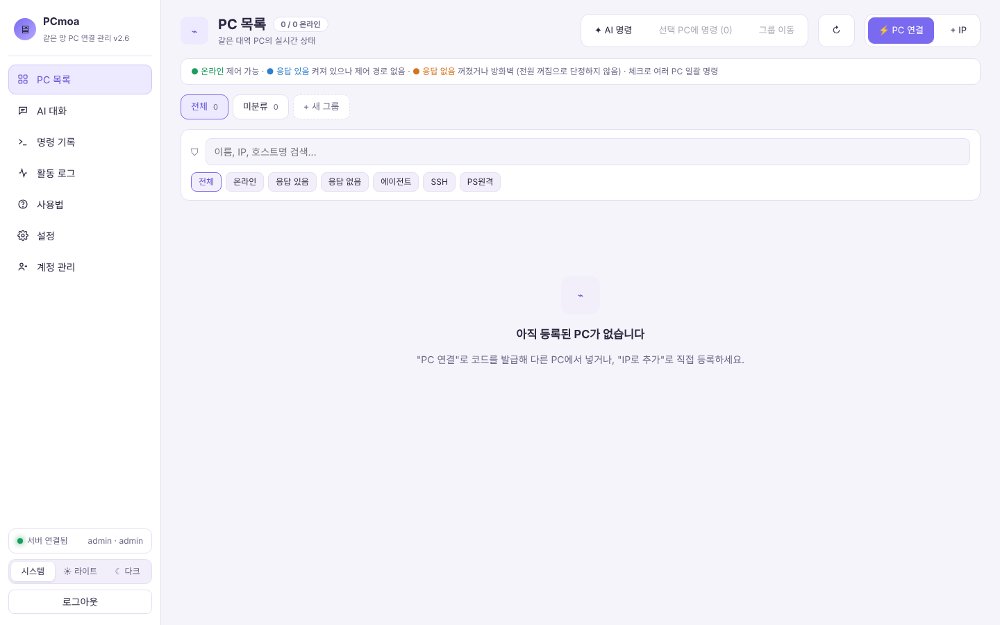

### 1-3. 다른 PC 연결하기

**① 메인 PC: 연결 링크 받기**

오른쪽 상단의 **⚡ PC 연결**을 누른 후 이름을 적습니다. 넣을 그룹을 고를 수도 있습니다(나중에 바꿔도 됩니다).

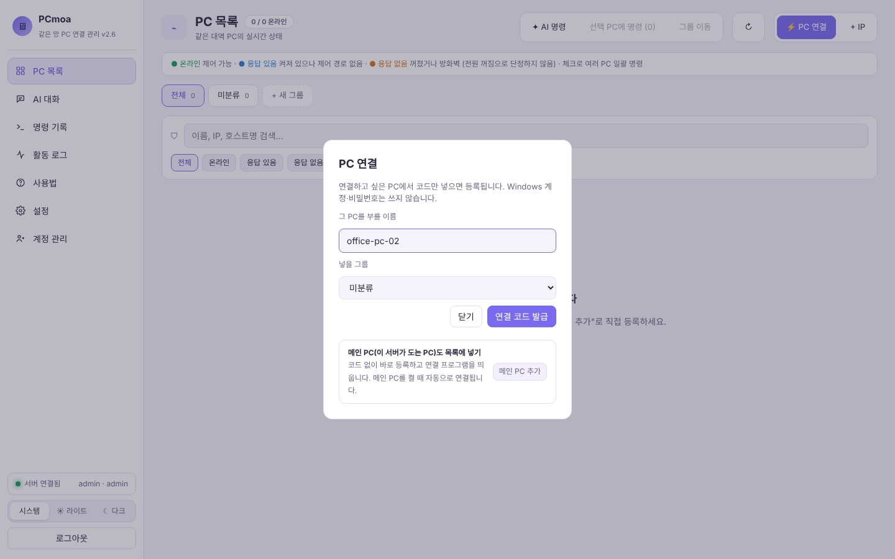

**[연결 코드 발급]**을 누르면 6자리 번호가 나오고, 번호 하단에 **연결 링크**가 나옵니다. 옆의 **[복사]**를 누르세요.

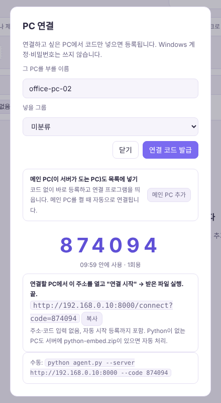

- 코드는 **10분 동안, 한 번만** 쓸 수 있습니다. 시간이 지나면 새로 발급하면 됩니다.

**② 연결할 PC: 링크 열기**

복사한 링크를 메신저나 메모 등으로 옮겨서, **연결할 PC의 브라우저 주소창**에 붙여 넣습니다.

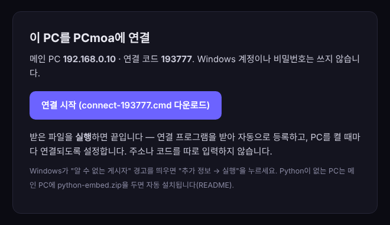

**[연결 시작]**을 누르면 `connect-123456.cmd` 같은 파일이 내려받아집니다. 이 파일을 실행하세요.

- Windows가 "Windows의 PC 보호" 파란 창을 띄우면 **추가 정보 → 실행**을 누르세요.
- 검은 창이 열리고 `[1/3] → [2/3] → [3/3] 완료!`가 나오면 끝입니다.

**③ 메인 PC: 확인**

대시보드에 방금 연결한 PC 카드가 **온라인**으로 나타납니다.

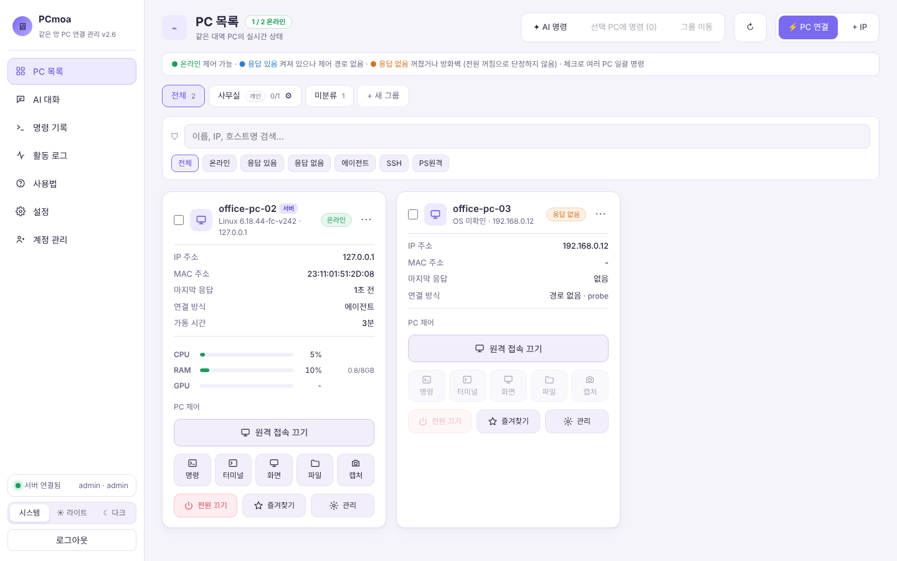

한 번 연결하면 그 PC를 켤 때마다 연결 프로그램이 자동으로 켜지므로 다시 할 일이 없습니다.

### 1-4. 메인 PC 자신도 목록에 넣기

⚡ PC 연결 창 가운데의 **[메인 PC 추가]**를 누르면 코드 없이 바로 등록됩니다.

### 1-5. 카드 상태 읽는 법

| 상태 | 뜻 | 할 수 있는 것 |
|---|---|---|
| 🟢 **온라인** | 연결 프로그램(또는 SSH)이 응답 | 모든 기능 |
| 🔵 **응답 있음** | PC는 켜져 있지만 제어할 경로가 없음 | 상태 보기만 |
| 🟠 **응답 없음** | 꺼져 있거나 방화벽에 막힘 (꺼졌다고 단정하지 않음) | 상태 보기 |

카드 아래의 CPU·RAM·GPU 막대는 사용률입니다(60% 이상 노랑, 85% 이상 빨강).

---

## 2. 기능별 사용법

각 기능 앞에 **이럴 때 쓰세요** 예시를 붙였습니다.

### 2-1. 그룹 만들기

> 이럴 때: 집 PC와 사무실 PC를 나눠 보고 싶을 때, 사무실 PC는 실수로 끄지 않게 막고 싶을 때

1. PC 목록 위의 **+ 새 그룹**을 누릅니다.
2. 이름을 적고 종류를 고릅니다.
   - **개인 공간**: 전원 끄기·켜기·재부팅 허용
   - **공공장소**: 전원 제어 기본 차단 (회사·학교 PC 등)
3. **[저장]**

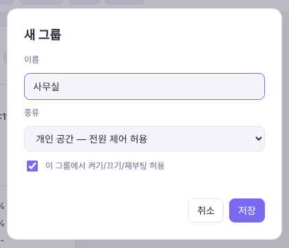

PC를 그룹에 넣으려면 카드를 체크하고 위쪽의 **그룹 이동**을 누르거나, 카드의 **⋯ → 그룹 이동**을 씁니다.

> 막 연결된 PC는 **미분류**에 들어가고, 미분류에서는 전원 제어가 막혀 있습니다. 전원을 다루려면 전원을 허용한 그룹으로 옮기세요.

### 2-2. 명령 실행

> 이럴 때: 옆 PC의 IP를 확인하고 싶을 때, 여러 PC에 같은 프로그램을 한꺼번에 깔고 싶을 때

1. 카드의 **명령**을 누릅니다.
2. 명령을 적고 **[실행]**. Windows는 PowerShell, Linux는 bash 명령입니다.
3. 아래 **결과**에 출력과 종료 코드(exit 0이면 성공)가 나옵니다.

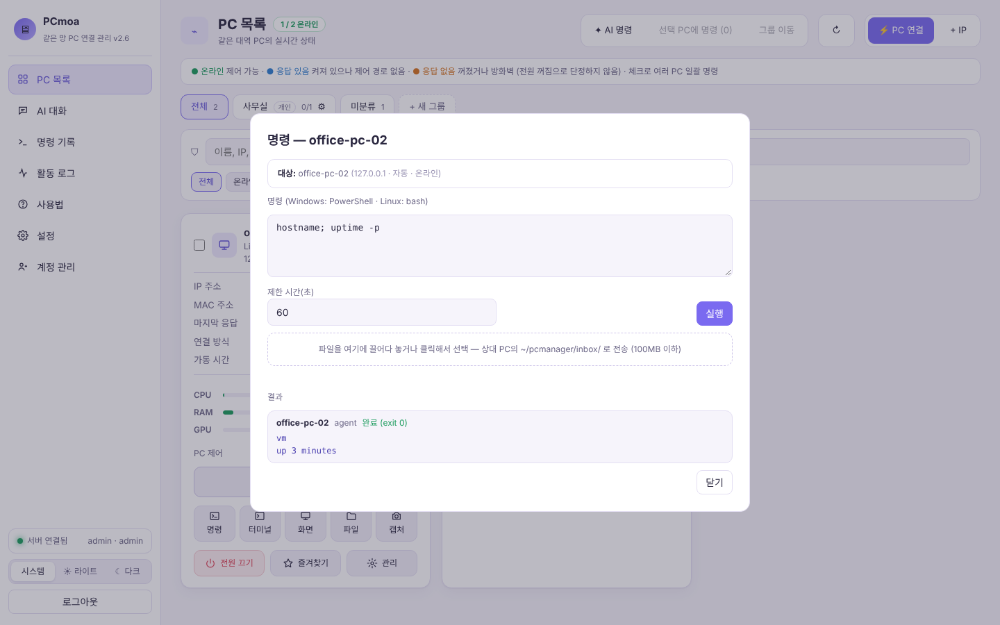

자주 쓰는 예시:

| 하고 싶은 일 | Windows (PowerShell) | Linux (bash) |
|---|---|---|
| PC 이름 확인 | `hostname` | `hostname` |
| IP 확인 | `ipconfig` | `ip -4 addr` |
| 실행 중인 프로그램 | `Get-Process \| Select -First 10` | `ps aux \| head` |
| 디스크 남은 용량 | `Get-PSDrive C` | `df -h` |
| 보낸 파이썬 파일 실행 | `python ~/pcmanager/inbox/main.py` | `python3 ~/pcmanager/inbox/main.py` |

**여러 PC에 한꺼번에:** 카드 왼쪽 위 체크 상자를 여러 개 체크 → 위쪽 **선택 PC에 명령 (N)** → 대상을 확인하고 실행.

### 2-3. 파일 보내기 (메인 PC → 그 PC)

> 이럴 때: 내 자리에서 만든 코드를 옆 PC에서 돌려 보고 싶을 때

1. 카드의 **명령**을 엽니다.
2. 가운데의 "파일을 여기에 끌어다 놓거나 클릭" 칸에 파일을 끌어다 놓습니다.
3. 그 PC의 `~/pcmanager/inbox/` 폴더에 저장됩니다(한 파일 100MB까지).
4. 같은 창에서 바로 실행 명령을 보내면 됩니다. 예: `python ~/pcmanager/inbox/main.py`

### 2-4. 파일 가져오기 (그 PC → 내 PC)

> 이럴 때: 옆 PC에서 학습한 결과 파일이나 로그를 내 PC로 옮기고 싶을 때

1. 카드의 **파일**을 누릅니다.
2. 위쪽에서 드라이브를 고르거나 경로를 적고 **이동**. `↑`는 상위 폴더, `⌂`는 사용자 폴더입니다.
3. 파일은 **[받기]**, 폴더는 **[zip 받기]**를 누르면 지금 보고 있는 브라우저로 내려받아집니다.

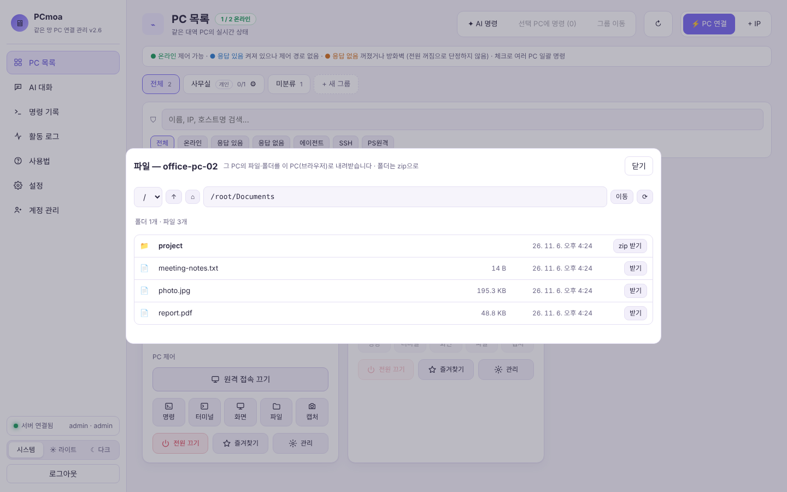

- 한 번에 4GB까지, 받은 파일은 SHA-256으로 손상 여부를 확인합니다.
- 서버에는 하루만 임시로 보관되고 자동으로 지워집니다.

### 2-5. 터미널

> 이럴 때: 명령을 여러 번 이어서 치고 싶을 때(`cd`로 이동하면서 작업 등)

1. 카드의 **터미널**을 누릅니다.
2. 위쪽 셸 목록에서 고릅니다. 그 PC에 실제로 있는 셸만 보입니다.
   - Windows: PowerShell · 명령 프롬프트(CMD) · Linux(WSL) · Git Bash
   - Linux: bash · zsh · sh
3. 평소처럼 입력합니다. `cd`로 이동한 위치가 유지되고, Tab 자동완성도 됩니다.

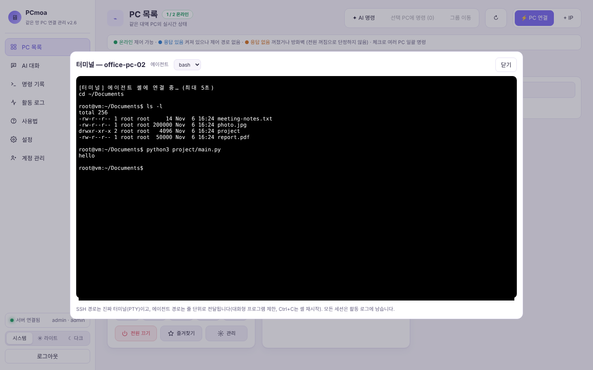

- 복사: 글자를 선택하고 Ctrl+C / 붙여넣기: Ctrl+V
- 선택한 글자 없이 Ctrl+C를 누르면 실행 중인 명령을 멈춥니다(연결 프로그램 경로에서는 셸을 새로 시작).
- vim, top처럼 화면 전체를 쓰는 프로그램은 제대로 안 보일 수 있습니다.

### 2-6. 화면 보기와 조종

> 이럴 때: 옆 PC에 뜬 오류 창을 내 자리에서 보고 닫고 싶을 때

1. 카드의 **화면**을 누르면 새 창으로 그 PC 화면이 실시간으로 보입니다.
2. 위쪽 **조종**을 켜면 마우스·키보드가 그 PC로 갑니다.
3. 조종 중에 그 PC에서 복사한 글자는 내 PC 클립보드로, 내 PC에서 복사한 글자는 Ctrl+V로 그 PC에 붙여 넣을 수 있습니다(글자만).

- 화면을 보는 동안 그 PC의 연결 프로그램 창에 **"'계정' 계정이 이 PC 화면을 보고 있습니다"**가 표시됩니다.
- 작업 관리자처럼 **관리자 권한 창**은 그냥은 조종이 안 됩니다. 화면 창 위에 노란 경고가 뜨면 **[관리자 권한으로 전환]**을 누르고, **그 PC 앞에서** UAC 창의 "예"를 눌러 주세요(처음 한 번).
- 한 장만 찍어 두고 싶으면 카드의 **캡처**를 쓰세요. 명령 기록에 남습니다.

### 2-7. 전원 끄기 · 원격 접속 끄기

| 버튼 | 하는 일 |
|---|---|
| **⏻ 전원 끄기** | 확인 창 뒤 5초 후 그 PC가 실제로 꺼집니다. 저장 안 한 작업은 사라질 수 있습니다. |
| **원격 접속 끄기** | 전원은 그대로 두고 명령·터미널·화면을 잠시 막습니다. 다시 누르면 켜집니다. |

> 꺼진 PC를 원격으로 켜는 기능(Wake-on-LAN)은 아직 버튼이 없습니다. 다음 버전에서 추가할 예정입니다.

> 카드에 **서버** 표시가 있는 PC는 대시보드가 도는 메인 PC입니다. 이 PC를 끄면 모든 관리가 멈춥니다.

### 2-8. 카드 관리 메뉴 (⋯)

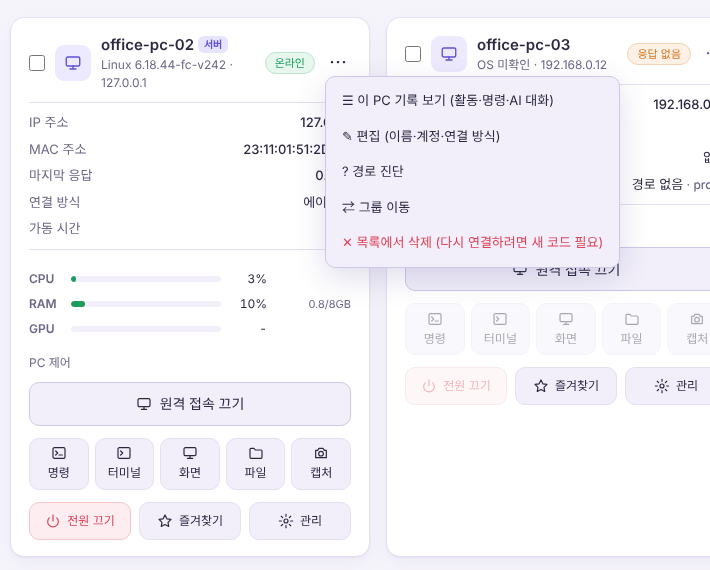

| 메뉴 | 하는 일 |
|---|---|
| 이 PC 기록 보기 | 그 PC의 활동 로그·명령 기록·AI 대화만 모아 보기 |
| 편집 | 이름, MAC, SSH 계정, 연결 방식 바꾸기 |
| 경로 진단 | 왜 연결이 안 되는지 단계별로 확인 |
| 그룹 이동 | 다른 그룹으로 옮기기 |
| 목록에서 삭제 | 카드를 지움 ([3장](#3-연결-해제와-완전-삭제) 참고) |

카드의 **즐겨찾기(★)**를 누르면 그 PC가 그룹의 대표 PC가 되어 맨 앞에 옵니다.

### 2-9. 연결 프로그램 없이 PC 추가하기 (+ IP)

> 이럴 때: 연결 프로그램을 깔 수 없는 PC를 상태만 보고 싶을 때, SSH가 켜진 Linux 서버를 관리하고 싶을 때

1. 오른쪽 상단 **+ IP** → 이름과 IP 주소를 적습니다.
2. 상태만 볼 거면 그대로 **[추가]**.
3. 명령까지 보내려면 그 PC의 계정(사용자명·비밀번호)을 적습니다. 서버가 SSH → PowerShell 원격 순서로 되는 길을 자동으로 찾습니다.

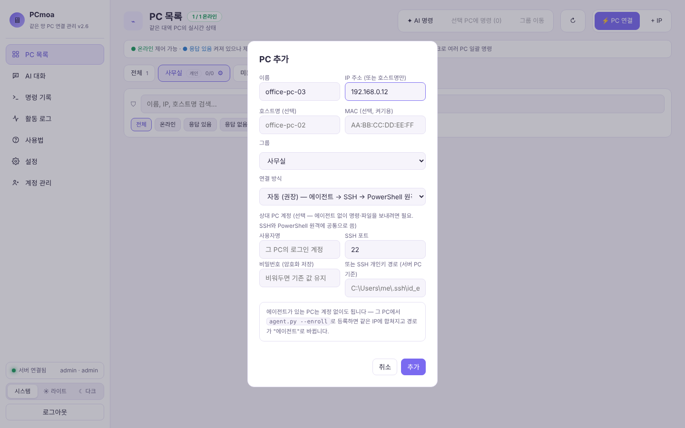

### 2-10. 기록 확인

- **명령 기록**: 누가, 언제, 어느 PC에, 무슨 명령을 보냈고 결과가 어땠는지
- **활동 로그**: 로그인, PC 연결·삭제, 터미널·화면 보기 시작, 파일 받기 등 모든 활동

위쪽 **PC** 선택 칸으로 한 PC만 걸러 볼 수 있습니다.

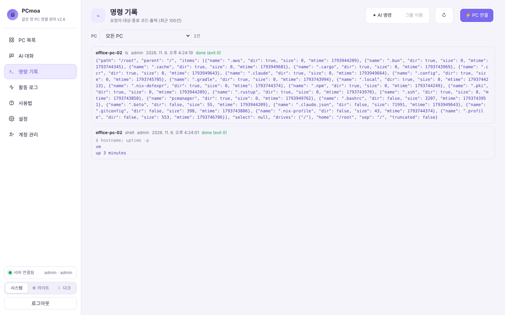

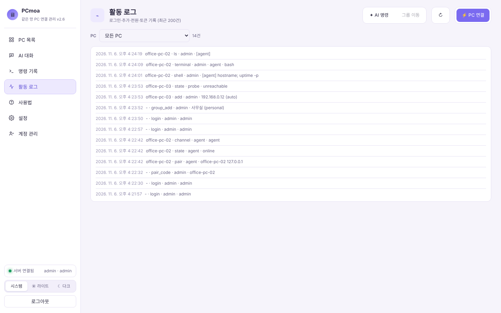

### 2-11. AI 대화 (선택 기능)

> 이럴 때: 명령어를 몰라도 "2번 PC에 파이썬 깔려 있는지 확인해 줘"처럼 말로 시키고 싶을 때

**준비:** Anthropic API 키가 필요합니다([console.anthropic.com](https://console.anthropic.com) → API Keys). 사용한 만큼 요금이 나옵니다.

1. **설정 → 내 API 키**에 이름과 키(`sk-ant-…`)를 넣고 **[+ 키 추가]** → **연결 확인**으로 동작을 확인합니다.
   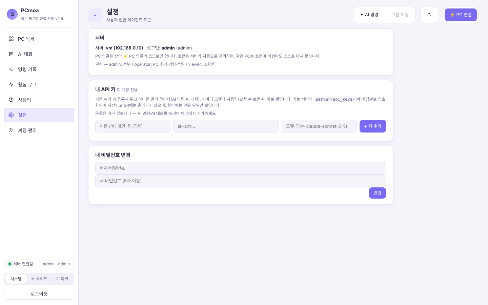
2. 사이드바 **AI 대화 → + 새 대화**.
3. 아래 칸에 하고 싶은 일을 적고 **[전송]**.
4. Claude가 명령을 만들면 **승인 카드**가 뜹니다. 내용을 확인하고 실행·수정·거절을 고릅니다.

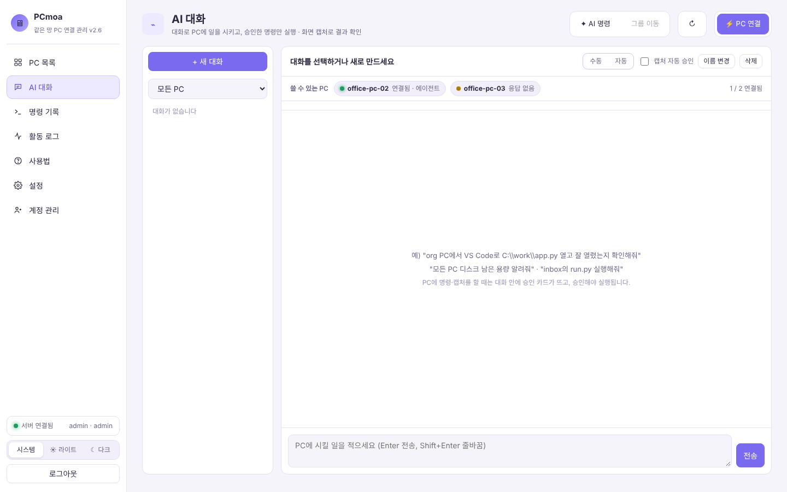

| 모드 | 동작 |
|---|---|
| **수동** (기본) | 모든 명령을 실행 전에 묻습니다. |
| **자동** | 안전한 명령은 바로 실행. 삭제·포맷, 종료·재부팅, 설치, 인터넷에서 받기, 레지스트리·계정 변경, 허용 폴더 밖 작업은 **자동이어도 항상 묻습니다.** |

- 화면 보기·명령·터미널은 API를 쓰지 않습니다. 요금은 AI 기능을 쓸 때만 나옵니다.
- 위쪽 **✦ AI 명령**은 대화 없이 한 번에 "여러 PC용 명령 계획"을 받는 기능입니다.

### 2-12. 편하게 쓰기

- `make_shortcut.bat` 더블클릭 → 바탕화면에 **PCmoa** 아이콘이 생깁니다.
- `make_shortcut.bat auto`로 실행하면 메인 PC를 켤 때 서버도 자동으로 켜집니다.
- Chrome/Edge 주소창 오른쪽 **[앱 설치]** → 작업 표시줄에 고정하면 앱처럼 쓸 수 있습니다.
- 같은 네트워크의 어느 PC에서든 `http://메인PC주소:8000`을 열면 같은 대시보드를 쓸 수 있습니다(로그인 필요).
- 사이드바 아래에서 라이트 / 다크 모드를 고를 수 있습니다.

---

## 3. 연결 해제와 완전 삭제

필요한 만큼 고르세요. 아래로 갈수록 확실하게 지웁니다.

| 하고 싶은 것 | 방법 | 다시 쓰려면 |
|---|---|---|
| 잠깐 원격 조작만 막기 | 카드의 **원격 접속 끄기** | 다시 누르기 |
| 목록에서만 빼기 | 카드 **⋯ → 목록에서 삭제** | 새 연결 코드로 다시 연결 |
| 그 PC에서 프로그램 완전히 지우기 | 아래 3-1 | 처음부터 다시 연결 |
| 메인 PC의 PCmoa 전체 지우기 | 아래 3-2 | 처음부터 다시 설치 |

> **목록에서 삭제만 하면** 그 PC의 연결 프로그램은 "등록이 없다"며 스스로 멈추지만, 자동 시작 등록은 남아 있습니다. 그 PC를 다시 쓰지 않을 거라면 3-1까지 하세요.

### 3-1. 연결한 PC에서 프로그램 완전히 지우기

**Windows** (링크로 연결한 경우, 프로그램은 `%LOCALAPPDATA%\PCManager`에 있습니다)

1. 그 PC에서 명령 프롬프트(cmd)를 열고:
   ```bat
   cd /d %LOCALAPPDATA%\PCManager
   python agent.py --uninstall
   ```
   Python이 없어 자동으로 받았던 PC라면 `python` 대신 `py\python.exe`를 쓰세요.
2. 자동 시작 해제 → 실행 중인 연결 프로그램 종료 → 등록 정보 삭제가 차례로 진행됩니다.
3. 마지막에 "작업 스케줄러: 권한이 없어 못 지움"이 나오면(관리자 권한 전환을 했던 PC), **관리자 PowerShell**에서:
   ```powershell
   schtasks /Delete /TN PCManagerAgent /F
   ```
4. 탐색기에서 `%LOCALAPPDATA%\PCManager` 폴더를 통째로 지웁니다.
5. 메인 PC 대시보드에서 그 PC 카드의 **⋯ → 목록에서 삭제**.

**Linux**

```bash
cd agent.py가_있는_폴더
python3 agent.py --uninstall
```
systemd 사용자 서비스 해제와 프로세스 종료까지 자동으로 합니다. 끝나면 그 폴더를 지우고, 대시보드에서 카드를 삭제하세요.

**`--uninstall`이 없는 예전 버전이라면** 직접 지우면 됩니다.
- Windows: `reg delete "HKCU\Software\Microsoft\Windows\CurrentVersion\Run" /v PCManagerAgent /f` → (있으면) `schtasks /Delete /TN PCManagerAgent /F` → 작업 관리자에서 python 프로세스 종료 → 폴더 삭제
- Linux: `systemctl --user disable --now pcmanager-agent` → `rm ~/.config/systemd/user/pcmanager-agent.service` → 폴더 삭제

### 3-2. 메인 PC에서 PCmoa 전체 지우기

1. 작업 표시줄의 **"PCmoa 서버"** 창을 닫아 서버를 끕니다.
2. 자동 시작을 등록했다면(`make_shortcut.bat auto`) 시작 프로그램 바로가기를 지웁니다. `Win + R` → `shell:startup` → **PCmoa** 바로가기 삭제.
3. 바탕화면의 **PCmoa** 바로가기를 지웁니다.
4. **관리자 PowerShell**에서 방화벽 규칙을 지웁니다.
   ```powershell
   Remove-NetFirewallRule -DisplayName "PCmoa"
   ```
5. PCmoa 폴더를 통째로 지웁니다. `server/` 안의 계정·PC 목록·API 키도 함께 지워집니다.
6. (선택) 설치한 라이브러리까지 지우려면 `pip uninstall -r requirements.txt`. 다른 프로그램이 같은 라이브러리를 쓸 수 있으니 확실할 때만 하세요.

---

## 4. 자주 생기는 문제와 해결

### 설치·서버

| 증상 | 원인과 해결 |
|---|---|
| `'python'은(는) 내부 또는 외부 명령...이 아닙니다` | Python이 없거나 PATH에 없음. Python을 다시 설치하며 **Add python.exe to PATH** 체크 |
| `pip install` 중 오류 | `python -m pip install --upgrade pip` 후 다시 시도 |
| `start_pcmoa.bat` 실행 후 "30초 안에 켜지지 않았습니다" | 작업 표시줄 "PCmoa 서버" 창의 오류 확인. `address already in use`면 8000 포트를 다른 프로그램이 쓰는 중 |
| 관리자 비밀번호를 놓쳤음 / 잊었음 | `cd server` → `python app.py reset-admin` → 새 비밀번호가 한 번 표시됨 |
| 로그인이 "잠금"됨 | 비밀번호 5번 틀리면 60초 잠금. 기다렸다 다시 시도 |

### 연결

| 증상 | 원인과 해결 |
|---|---|
| 연결할 PC에서 링크가 안 열림 | ① 메인 PC 방화벽 8000 포트([1-1](#1-1-메인-pc에-설치하기) 3번) ② 두 PC가 같은 네트워크인지 ③ 메인 PC 서버가 켜져 있는지 |
| "연결 코드가 틀리거나 만료됐습니다" | 10분이 지났거나 이미 쓴 코드. ⚡ PC 연결에서 새로 발급 |
| 받은 `.cmd` 실행 시 "이 PC에 Python이 없습니다" | 메인 PC `server/` 폴더에 `python-embed.zip`을 넣으면 자동 설치됨 ([7-1](#7-1-windows)) |
| 받은 파일이 바로 지워짐 / 실행이 막힘 | 백신이 처음 보는 스크립트를 막은 경우. "추가 정보 → 실행" 또는 백신 예외에 추가 |
| 카드가 계속 "응답 없음" | 그 PC가 켜져 있는지, 연결 프로그램 창이 떠 있는지 확인. 카드 **⋯ → 경로 진단**으로 어디서 막혔는지 확인. 자세한 오류는 그 PC의 `agent.log` |
| 연결 프로그램 창에 "등록이 필요합니다" | 메인 PC 목록에서 카드가 삭제된 상태. 새 코드로 다시 연결 |
| 자리를 옮겼더니 연결이 안 됨 | 메인 PC의 IP가 바뀐 경우. 그 PC에서 `python agent.py --server http://새주소:8000 --code 새코드`로 다시 연결 |

### 기능

| 증상 | 원인과 해결 |
|---|---|
| 화면이 안 보임 | 화면 창에 이유가 표시됨. "예전 버전"이면 [원격으로 업데이트]. Linux는 X11 세션 필요 |
| 조종하는데 클릭이 안 먹힘 | 앞에 있는 창이 관리자 권한 창. [관리자 권한으로 전환] 후 그 PC 앞에서 UAC "예" |
| 잠금 화면·로그인 화면 조종 불가 | Windows 보안상 원격 조종 불가 (정상) |
| 전원 끄기 버튼이 회색 | 미분류나 "공공장소" 그룹. 전원을 허용한 그룹으로 옮기거나 그룹 ⚙에서 허용 |
| 터미널에서 vim/top 화면이 깨짐 | 연결 프로그램 경로는 줄 단위 전달이라 제한됨. SSH 경로를 쓰면 정상 |
| 터미널 붙여넣기(우클릭)가 안 됨 | 브라우저 보안상 `http://IP` 주소에서는 제한. Ctrl+V 사용 |
| AI "연결 확인" 실패 | 설정 화면의 단계별 결과 확인. ①접속 실패면 메인 PC 인터넷, 회사·학교 망 SSL 검사면 `pip install truststore` 후 서버 재시작. ②인증 실패면 키를 다시 복사 |

해결이 안 되면 [Issues](https://github.com/juyung861-glitch/PCmoa/issues)에 증상, 메인 PC/연결 PC의 OS, `agent.log` 마지막 부분을 남겨 주세요.

---

## 5. 권한별로 할 수 있는 것

계정마다 PC·기록·API 키가 완전히 분리됩니다. **다른 계정의 PC는 보이지도 않습니다.** 권한은 세 가지입니다.

| 기능 | viewer | operator | admin |
|---|:---:|:---:|:---:|
| 내 PC 목록·상태 보기 | ✅ | ✅ | ✅ |
| 명령 기록·활동 로그 보기 | ✅ | ✅ | ✅ |
| 내 비밀번호 바꾸기 | ✅ | ✅ | ✅ |
| PC 연결·추가·삭제, 그룹 관리 | ❌ | ✅ | ✅ |
| 명령·파일 전송·파일 가져오기 | ❌ | ✅ | ✅ |
| 터미널, 화면 보기·조종, 캡처 | ❌ | ✅ | ✅ |
| 전원 끄기·켜기, 원격 접속 끄기 | ❌ | ✅ | ✅ |
| API 키 등록, AI 대화·AI 명령 | ❌ | ✅ | ✅ |
| **계정 관리** (권한 변경, 비밀번호 초기화, 비활성화, 삭제, 회원가입 허용 끄기) | ❌ | ❌ | ✅ |

- **회원가입**으로 만든 계정은 operator입니다. 자기가 연결한 PC만 다룰 수 있습니다.
- 처음 만들어지는 `admin`이 유일한 관리자입니다. 마지막 admin은 권한을 내리거나 삭제할 수 없습니다.
- 권한 변경은 상대가 다음에 무언가를 누르는 순간 바로 적용됩니다.

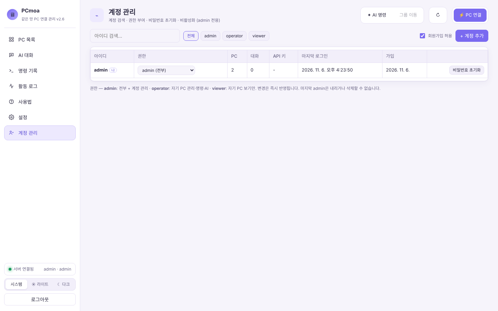

**이렇게 쓰면 좋아요:** 팀 PC를 같이 관리한다면 한 사람이 admin으로 PC를 연결하고, 다른 사람은 각자 operator 계정을 만들어 자기 PC를 연결하세요. 상태만 보여 줄 사람은 viewer로 바꿔 주면 됩니다.

---

## 6. 안전하게 쓰기

PCmoa는 다른 PC에 명령을 실행하고 화면을 조종하는 도구입니다. 편한 만큼 아래는 꼭 지켜 주세요.

### 꼭 할 것

1. **첫 로그인 후 admin 비밀번호 바꾸기** (설정 → 내 비밀번호 변경)
2. **혼자 쓰거나 팀만 쓸 거면 회원가입 끄기.** 기본값은 회원가입 허용이라, 같은 네트워크의 누구나 계정을 만들 수 있습니다(남의 PC는 못 보지만, 계정이 생기는 것 자체를 막는 게 안전합니다). → **계정 관리** 오른쪽 위 **회원가입 허용** 체크 해제
3. **본인 소유이거나 허락받은 PC에만 연결하기.** 회사·학교 PC는 원격 접속 도구 사용 규정을 먼저 확인하세요.
4. **메인 PC 화면 잠그기.** 대시보드가 열린 메인 PC는 모든 PC의 열쇠입니다. 자리를 비울 때 `Win + L`.
5. **`server/` 폴더 공유 금지.** `config.json`, `pcs.db`, `api_keys/`에 비밀 정보가 있습니다. Git에는 자동으로 빠지지만, 폴더를 압축해 남에게 보내지 마세요.

### PCmoa가 기본으로 해 주는 것

- 연결은 메인 PC에서 발급한 **10분짜리 1회용 코드**가 있어야만 됩니다.
- 화면을 보는 중이면 **상대 PC에 표시**됩니다. 연결 프로그램 창은 숨겨지지 않습니다.
- 비밀번호는 PBKDF2-SHA256(60만 번 반복, 계정별 솔트)으로 저장, 5회 틀리면 잠금, 로그인은 12시간 유지.
- PC마다 다른 토큰, API 키·SSH 비밀번호는 암호화 저장.
- 모든 명령·파일 전송·화면 보기가 기록에 남습니다.
- AI가 만든 명령은 사람이 승인해야 실행되고, 위험한 명령은 자동 모드에서도 묻습니다.

### 더 조이고 싶을 때

- 특정 PC는 화면 보기를 아예 막기: 그 PC에서 연결 프로그램을 `--no-screen`으로 실행
- 메인 PC가 바뀐 코드로 연결 프로그램을 자동 업데이트하지 않게: `--no-update`
- 오래 안 쓰는 PC는 **원격 접속 끄기**로 막아 두기
- 퇴사·수료 등으로 안 쓰게 된 PC는 [3장](#3-연결-해제와-완전-삭제)대로 완전히 지우기

### 쓰면 안 되는 환경

- **통신이 아직 HTTP**입니다. 같은 네트워크 안의 다른 사람이 마음먹으면 오가는 내용을 엿볼 수 있습니다. 카페·공항 같은 **공용 와이파이에서는 쓰지 마세요.** (HTTPS는 다음 버전에서 지원 예정)
- 공유기 포트 포워딩으로 **인터넷에 8000 포트를 열지 마세요.** 외부 접속용으로 만들지 않았습니다. 밖에서 쓰고 싶다면 Tailscale 같은 VPN으로 같은 네트워크를 만든 뒤 쓰세요.

---

## 7. Windows / Linux 환경별 안내

### 7-1. Windows

**메인 PC로 쓸 때**
- `start_pcmoa.bat`으로 켜고 끄는 게 가장 쉽습니다. `.venv` 폴더(가상환경)가 있으면 그 Python을 씁니다.
- 처음 실행 때 "Windows 보안 경고: 액세스 허용" 창이 뜨면 **개인 네트워크**에 체크하고 허용하세요.

**연결할 PC로 쓸 때**
- 링크 방식이면 `%LOCALAPPDATA%\PCManager`에 설치되고, 로그인할 때 자동으로 켜집니다(관리자 권한 불필요, 레지스트리 `HKCU\...\Run`).
- **Python이 없는 PC**를 연결하려면 메인 PC에 한 번만 준비해 두세요.
  1. [python.org/downloads/windows](https://www.python.org/downloads/windows/)에서 **Windows embeddable package (64-bit)** zip 다운로드
  2. 이름을 `python-embed.zip`으로 바꿔 메인 PC의 `server/` 폴더에 넣기
  3. 이후 링크로 연결하면 그 PC의 `PCManager` 폴더에만 Python이 풀립니다(시스템에 설치되지 않음).
- 관리자 권한 창까지 조종하려면 그 PC에서 한 번 `python agent.py --install-admin` (또는 화면 창의 [관리자 권한으로 전환]). 작업 스케줄러 `PCManagerAgent`로 등록됩니다.
- 터미널에서 Linux(WSL)를 쓰려면 그 PC에서 관리자 PowerShell로 `wsl --install` → 재부팅 → 연결 프로그램 다시 켜기.

**연결 프로그램 없이 관리하기 (PowerShell 원격)**
그 PC 관리자 PowerShell에서 `Enable-PSRemoting -Force` → 메인 PC에서 **+ IP**로 추가하며 Windows 계정을 입력하면 명령을 보낼 수 있습니다.

### 7-2. Linux

**메인 PC로 쓸 때**
```bash
git clone https://github.com/juyung861-glitch/PCmoa.git
cd PCmoa
pip install -r requirements.txt     # 배포판에 따라 python3 -m venv .venv 후 설치 권장
cd server
python3 app.py
```
방화벽을 쓰고 있다면 8000 포트를 엽니다. 예) Ubuntu: `sudo ufw allow 8000/tcp`

**연결할 PC로 쓸 때**
링크로 받는 `.cmd` 파일은 Windows 전용입니다. Linux에서는 명령 한 줄로 연결합니다.
```bash
mkdir -p ~/pcmoa && cd ~/pcmoa
curl -O http://192.168.0.10:8000/download/agent.py      # 메인 PC 주소로 바꾸기
pip install psutil mss pillow pynput                    # 화면 기능이 필요 없으면 psutil만
python3 agent.py --server http://192.168.0.10:8000 --code 123456 --install
```
- `--install`을 붙이면 systemd 사용자 서비스(`pcmanager-agent`)로 등록돼 로그인할 때 자동으로 켜집니다.
- **화면 보기·조종**은 X11 세션에서만 됩니다(Wayland 불가). Ubuntu는 로그인 화면 오른쪽 아래 톱니바퀴에서 "Ubuntu on Xorg"를 고르세요.
- **클립보드 공유**에는 `xclip`(또는 `xsel`)이 필요합니다: `sudo apt install xclip`
- GPU 사용률은 NVIDIA(`nvidia-smi`)만 표시됩니다.

**연결 프로그램 없이 관리하기 (SSH)**
그 PC에 OpenSSH 서버가 켜져 있으면(`sudo apt install openssh-server`) 메인 PC에서 **+ IP**로 추가하며 계정을 입력하면 됩니다. SSH 경로의 터미널은 vim·top도 되는 진짜 터미널입니다.

### 7-3. 한눈에 비교

| 항목 | Windows | Linux |
|---|---|---|
| 연결 방법 | 링크 → `.cmd` 실행 | `agent.py` 받아서 명령 한 줄 |
| 자동 시작 | 레지스트리 Run (관리자 전환 시 작업 스케줄러) | systemd 사용자 서비스 |
| 설치 위치 (링크 방식) | `%LOCALAPPDATA%\PCManager` | 직접 정한 폴더 |
| 터미널 셸 | PowerShell · CMD · WSL · Git Bash | bash · zsh · sh |
| 화면 보기 | 추가 설치 없이 됨 | X11 + `mss pillow pynput` |
| 클립보드 | 기본 지원 | `xclip` 또는 `xsel` |
| 에이전트 없이 | PowerShell 원격(WinRM) | SSH |
| 완전 삭제 | `agent.py --uninstall` + 폴더 삭제 | `agent.py --uninstall` + 폴더 삭제 |
